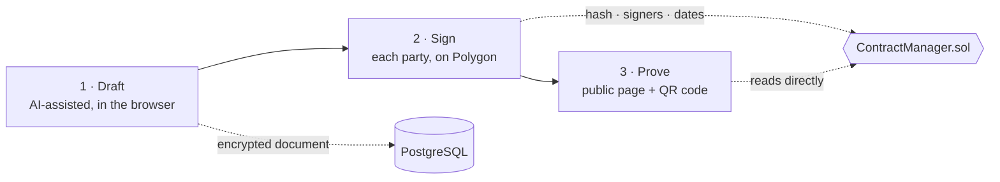

<div align="center">


# Cachetify

**Draft a contract with AI, have every party sign it, and prove it was never altered, without having to trust Cachetify.**

[](https://github.com/Juste130/cachetify/actions/workflows/ci.yml)
[](https://nextjs.org/)
[](https://polygon.technology/)
[](https://nodejs.org/)
[](./LICENSE)

[Features](#features) · [How it works](#how-it-works) · [Getting started](#getting-started) · [Deployment](#deployment) · [Testing](#testing) · [Security](#security)

</div>

---

## Overview

Cachetify is a contract management platform for people with no legal or technical background. A user describes the agreement in plain language, the AI drafts it, every party signs, and the proof of what was signed is anchored on the Polygon blockchain.

The document itself never goes on-chain. Only its **SHA-256 fingerprint**, the **signers' addresses** and the **date of each signature** are written to the smart contract. The document stays encrypted, off-chain. Months later, anyone can check that a certificate matches what was signed, by reading the blockchain directly, without relying on Cachetify's servers.

Built as the practical component of a Licence (undergraduate) thesis in Software Engineering at **IFRI, Université d'Abomey-Calavi (Bénin)**.

## Features

| | |
|---|---|
| **AI-assisted drafting** | Generates a contract from a plain-language description (Groq, `openai/gpt-oss-120b` by default), suggests and improves clauses, and flags missing ones before signature. |
| **On-chain proof, off-chain content** | Only the hash, the signers and the signature dates are public. The contract text never touches the chain. |
| **Multi-party signing** | Each signer confirms on-chain. The contract activates automatically once the last signature lands. |
| **Independent verification** | Each certificate carries a QR code pointing to a public page that re-reads the hash and signatures from the blockchain, in the visitor's own browser. Signers appear as initials only. |
| **Encrypted storage** | Documents are encrypted at rest with AES-256-GCM, one key per document, under a master key held outside the database. |
| **No crypto knowledge needed** | Privy creates an embedded wallet for each account and sponsors gas: a signer never sees a seed phrase or pays a transaction fee. |

## How it works



1. **Draft.** The creator writes or imports the contract, assisted by the AI. The encrypted document is stored in PostgreSQL.
2. **Sign.** The contract is registered on-chain with its fingerprint. Each party signs from their Privy wallet. Signatures are direct blockchain transactions from the browser, not API calls.
3. **Prove.** Once all parties have signed, an official certificate is issued. Anyone can scan its QR code and check the fingerprint and signatures against the blockchain.

## Tech stack

| Layer | Technology |
|---|---|
| Application | Next.js 15 (App Router, Route Handlers), React 19, TypeScript, Tailwind CSS 4, Radix UI |
| Data | PostgreSQL with Prisma 5 |
| Authentication and wallets | Privy (email and Google login, embedded wallets, gas sponsorship) |
| Blockchain | Solidity smart contract on Polygon Amoy, ethers.js 6, Hardhat |
| AI | Groq API |
| Hosting | Netlify (Next.js runtime and scheduled functions) |

## Architecture

A single full-stack Next.js application sits in front of one deliberately narrow smart contract. Everyday operations (accounts, drafting, encrypted storage, email) stay off-chain in PostgreSQL. Only the proof is public. See [`contracts/SMART_CONTRACTS.md`](./contracts/SMART_CONTRACTS.md) for exactly what the contract does and does not do.

```
cachetify/
├── src/
│   ├── app/          Pages and API routes (app/api/**/route.js)
│   ├── components/   React components
│   ├── hooks/        React hooks (auth, contract interactions)
│   ├── lib/          Client utilities, API clients, web3 helpers
│   └── server/       Server logic: services, controllers, Prisma client, auth, rate limiting
├── prisma/           Database schema and migrations
├── netlify/
│   └── functions/    Scheduled function that keeps the on-chain contract cache in sync
└── contracts/        ContractManager.sol, Hardhat tests and deploy scripts (separate npm project)
```

`contracts/` has its own `package.json` and `node_modules`, so Hardhat's toolchain is never bundled into the app. It reads the same root `.env`.

## Getting started

### Prerequisites

- Node.js 20 or later, npm 10 or later
- PostgreSQL 14 or later (a local instance is available through `docker compose up -d`, on port 5433)
- A Polygon Amoy RPC endpoint (Alchemy, for example)
- A [Privy](https://www.privy.io/) app and a [Groq](https://console.groq.com/) API key

### Installation

```bash
git clone https://github.com/Juste130/cachetify.git
cd cachetify
npm install
cp .env.example .env    # then fill it in, and never commit it
```

### Environment variables

The full list, with comments, is in [`.env.example`](./.env.example). The essentials:

| Variable | Purpose |
|---|---|
| `DATABASE_URL` | PostgreSQL connection string |
| `MASTER_ENCRYPTION_KEY` | Master key used to encrypt each document's key |
| `JWT_SECRET`, `JWT_REFRESH_SECRET` | Session token signing |
| `POLYGON_RPC_URL` | Polygon RPC endpoint (`ALCHEMY_POLYGON_TESTNET_RPC_URL` takes precedence when set) |
| `CONTRACT_MANAGER_ADDRESS` | Deployed `ContractManager` address |
| `ADMIN_WALLET_ADDRESS` | Platform administrator wallet |
| `GROQ_API_KEY` | AI drafting |
| `PRIVY_APP_ID`, `PRIVY_APP_SECRET` | Server-side Privy verification |
| `NEXT_PUBLIC_PRIVY_APP_ID`, `NEXT_PUBLIC_CONTRACT_MANAGER_ADDRESS`, `NEXT_PUBLIC_RPC_URL` | Same values, exposed to the browser |

The app checks these on startup and **refuses to start in production** if one is missing, or if `KYC_MOCK_MODE` is not explicitly set to `false` (see [`src/server/config.js`](./src/server/config.js)). Anything prefixed with `NEXT_PUBLIC_` ships in client-side JavaScript: never put a secret there.

### Database and development server

```bash
npx prisma migrate dev     # apply migrations (development database only)
npm run dev                # http://localhost:3000, frontend and API together
```

> **Testing on a phone:** Privy's embedded wallet needs a secure context, so `http://<local-ip>:3000` will not work. Use an HTTPS tunnel instead (for example `npx cloudflared tunnel --url http://localhost:3000`) and add its URL to the allowed origins in the Privy dashboard.

### Scripts

| Command | Description |
|---|---|
| `npm run dev` | Development server (Turbopack) |
| `npm run build` / `npm start` | Production build and server |
| `npm run lint` | ESLint |
| `npm test` | Jest test suite |
| `npm run prisma:migrate` / `npm run prisma:studio` | Migrations and database browser |
| `npm run create-admin` | Create an administrator account |

## Smart contract

`ContractManager.sol` records, for each contract, its SHA-256 fingerprint, a reference to the encrypted document, its signers and their roles, and the timestamp of each signature. A contract is finalized automatically when the last signature is collected. An emergency pause is available to the owner.

```bash
cd contracts
npm install
npx hardhat compile
npx hardhat test
npx hardhat run scripts/deploy.ts --network amoy   # deploy to Polygon Amoy
```

The contract is never deployed with the application: `contracts/` is a development tool for compiling, testing and deploying it to Polygon. Details in [`contracts/SMART_CONTRACTS.md`](./contracts/SMART_CONTRACTS.md).

## Deployment

The application deploys to **Netlify** as a single unit, configured in [`netlify.toml`](./netlify.toml):

- `@netlify/plugin-nextjs` builds and serves the Next.js app.
- `netlify/functions/` runs as scheduled functions, which keep the contract cache in sync with the blockchain.
- Every variable from `.env` must be set in the Netlify environment, including the `NEXT_PUBLIC_` ones.

Deployment is triggered by Netlify's GitHub integration. [GitHub Actions](./.github/workflows/ci.yml) runs type checking, lint, unit tests, the production build and the smart contract tests on every push, as a quality gate.

## Testing

```bash
npm test                          # Jest: AI guardrails, encryption, certificate and public verification, escrow, incidents
cd contracts && npx hardhat test  # smart contract
```

## Security

- **Encryption at rest.** AES-256-GCM with one key per document. The master key lives outside the database.
- **Minimal public data.** The blockchain holds only the hash, the signers and the dates. The public verification page shows initials, never full names, titles or document content, and is reached through a non-guessable token.
- **Wallet custody.** Delegated to Privy. The application never handles private keys.
- **API protection.** Rate limiting on the sensitive endpoints (AI generation, authentication, invitations, signature reminders, wallet operations and the public verification page) and input validation.
- **Same-origin by design.** Frontend and API share one origin, which removes a whole class of CORS and cross-site cookie issues.

To report a vulnerability, please contact the maintainer privately instead of opening a public issue.

## Project scope

The thesis covers the **Draft → Sign → Prove** flow. Two modules exist in the codebase but sit outside that scope: an **escrow** module, disabled by default (`FEATURE_ESCROW`), and **identity verification (KYC)** through Smile ID. Design notes on deferred decisions are in [`escrow-onchain-deferred.md`](./escrow-onchain-deferred.md) and [`nft-architecture-deferred.md`](./nft-architecture-deferred.md).

## Contributing

Setup, coding standards and the commit and pull request workflow are described in [CONTRIBUTING.md](./CONTRIBUTING.md).

## License

Distributed under the MIT License. See [LICENSE](./LICENSE).

## Author

**Sènami Juste HOUEZO** ([@Juste130](https://github.com/Juste130)): Licence thesis project, IFRI, Université d'Abomey-Calavi.
